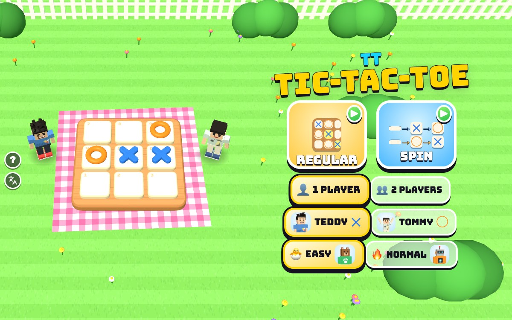

# TT Tic-Tac-Toe

[](https://adong.github.io/tic-tac-toe-tt/)

Press **?** any time (or tap the round **?** button on the left edge) to see the keys. The game waits while you look.
Tap the language button under it (the A文 icon) to switch between English and 中文; the dashboard and every game remember the choice.

Tic-tac-toe on a big wooden board in the garden, with Teddy as X and Tommy as O: the classic game, or SPIN, where every tap turns a square over. 1 or 2 players.

**中文：** 花园里的大井字棋，Teddy 是 X，Tommy 是 O：普通模式，或者旋转模式（每点一下，格子就翻一面）。单人或双人。

A chunky tic-tac-toe game starring Teddy and Tommy, built with Claude Code from plain JavaScript and Three.js on the shared Claude Games kit. The board sits on a picnic blanket on the lawn, with the boys standing beside it. There are no image, model or audio files: the boys are the kit's blocky characters, every texture is painted on a canvas, and every sound is synthesised.

The name is a working title. It lives in one constant, `TTT_TITLE` in `js/title.js`, and the page title, the logo and the ? panel read it from there.

## Play

- **Double-click `index.html`.** It works offline because Three.js and the kit are copied into `kit/`. Without internet the title font falls back to Arial Black.
- **Send one file:** `dist/tic-tac-toe-tt.html` is the whole game in one page. AirDrop or email it, then open it in a browser.
- Rebuild that file after any edit: `python3 kit/tools/bundle.py . --name tic-tac-toe-tt`

### A match

- **A match is up to 5 rounds.** The first to win 3 rounds wins it; a draw uses up a round, and after 5 rounds whoever won more takes it (level is a TIE MATCH). The dots on the scoreboard show each round: blue for an X win, orange for an O win, grey for a draw.
- **Who goes first swaps every round.** You go first in round 1 (Teddy, in 2 players).
- **A win** gets a glowing line across the three, confetti (when a kid wins), the winner's signature move (Teddy's boxing combo or 🏀 jump shot, Tommy's Y with peace fingers) and a silly shrug from the loser. Then **▶** for the next round, and **PLAY AGAIN** when the match is over.
- **Good moves get a cheer:** NICE! for a two-in-a-row (or the middle square first), BLOCKED! for stopping a line, SUPER! for two ways to win at once, POOF! for spinning your brother's mark away. A spin that finishes the other side's line gets OOPS!

## Modes

**Teddy is always X (blue) and Tommy is always O (orange).** In 1 player you pick which brother you are, and you play a friend from the kit: **🐣 EASY is Bruno the bear**, **🔥 NORMAL is Bolt the robot**. In 2 players Teddy and Tommy take turns on one device.

**⭕ REGULAR:** each square is empty or taken (2 states). On your turn put your mark on an empty square. Three in a row wins; a full board is a draw.

**🌀 SPIN:** each square has 3 states, and **every tap spins a square one step**. The tile hops and flips over like a coin, and the mark changes while it's upside down.

- **On your turn, spin any one square.** Your tap makes **your** mark first:
  - **Teddy** spins empty → X → O → empty.
  - **Tommy** spins the other way: empty → O → X → empty.
  - So for both: tap an empty square and it's yours, tap your brother's mark and it's gone (POOF!), tap your own mark and it turns into his (oops!).
- **After the spin**, a line of three X is a win for Teddy and a line of three O a win for Tommy, **whoever spun it**. Careful: turning your own mark over can finish your brother's line.
- **30 spins with no winner is a draw**, so a game always ends. The spin bar under the scoreboard shows what a tap does for whoever is spinning now, and the count.
- **Why mirrored:** Alan's first idea was one cycle for both (empty → X → O → empty) and a rule that you can't spin the square your brother just spun. Solving every possible game showed two problems. With that rule, X going first always wins in 3 spins: X spins the middle, Tommy can't touch it, and every other square he spins turns into an X. And with one cycle, every tap on an empty square makes an X, so Tommy's own taps keep helping Teddy: X won 88% of random games and about 97% between kid-like players. Alan picked the mirrored spin with no lock, which is fair: a draw with perfect play, and close to 50/50 in casual play.

**Levels (1 player):**

- **🐣 EASY** (the default, for Tommy, 5): Bruno plays at random. He takes a win he could make only 4 times in 10 and blocks yours only 3 times in 10, and in SPIN he only sometimes avoids spinning your line in for you.
- **🔥 NORMAL** (for Teddy, 8): Bolt plays REGULAR perfectly (he never loses; the best you can do is a draw). In SPIN he looks 3 spins ahead, but now and then (8% of his turns) he doesn't look and spins any square that doesn't give you a line, so he can miss your threat.

## Controls

| | Keys | Touch |
|---|---|---|
| play a square (laid out like a number pad: 7 8 9 on top) | 1 – 9 | tap the square |
| move round the board · play the square | ← ↑ → ↓ · Enter or Space | |
| call your brother (2 players: high five) | T | his face, bottom right (🙌 in 2 players) |
| start this round again | R | 🔄 on the pause screen |
| pause · sound | P or Esc · M | ⏸️ · 🔊 |
| menu: REGULAR · SPIN | 1 · 2 | the two big tiles |
| menu: Teddy or Tommy · 1 or 2 players · level | ← → · ↑ ↓ · L | the buttons under the tiles |

- **On a computer** the tiles show their number-pad digit in the corner, and the square under the mouse (or the arrow-key cursor) shows a see-through preview of what a tap would make.
- **The mark that bobs over a boy's head** shows whose turn it is.

## Call your brother (companion mode)

**1 player:** the CPU is a friend from the kit, so your brother is free to help. Call him with **T** or by tapping his face (bottom right), **any time and as often as you like** (`Kit.roster.buddyFor`: Tommy for Teddy, Teddy for Tommy).

- **He pops in** next to the board in a puff of stars, at his roster `buddyScale` (a smaller Tommy, a slightly smaller Teddy), with his name tag.
- **He says hi** with his signature move (Tommy's Y with peace fingers, Teddy's boxing combo) and **tosses you a treat** (🍦 💧 🧃 🍪 🍉 🍌) that arcs into your hand: "🧃 JUICE BOX FROM TOMMY!"
- **In ⭕ REGULAR he protects you with a hint:** he turns and points, the square glows gold with a bouncing 👇, and a toast says "TOMMY SAYS: HERE!" ("WIN HERE!" when it wins, "BLOCK HERE!" when it stops the CPU). On 🐣 Easy he points at the best square (from a look-ahead); on 🔥 Normal at the square that wins, else the one that blocks the CPU's win, else a good one. If it's the CPU's turn when he arrives, he waits for yours.
- **Once you've played**, he does his goodbye move and pops out. Call him again while he's there and he says hi again, brings another treat and points again.

**1 player in 🌀 SPIN: he makes mischief instead** (Alan's idea). He pops in, says hi and tosses the treat the same way, then does one of two things, half and half:

- **FLIP!** He points at a mark and it flips over: to empty, or to the other mark (X → O, O → X), picked at random. "TOMMY FLIPPED ONE!"
- **BOOM!** He throws a 💣 (it whistles) onto a row or a column with marks in it. Everything there flies off and the screen shakes. "💣 TOMMY BOMBED A ROW!"
- **It isn't anyone's turn and it isn't a spin:** the spin count and whose turn it is stay the same.
- **He's on your side, just wild:** a flip never finishes the CPU's line. A flip that finishes *your* line wins you the round. A bomb can wipe out your marks too, and then you shrug.
- Call him again while he's there for more mischief. On an empty board he has nothing to do: "TOMMY: NOTHING TO FLIP YET!"

**2 players:** both brothers are already at the board, so **T** (or 🙌) is a **high five**: they run together behind the board, slap hands (both hands, 💥) and run back. It doesn't change the game.

## Make it yours

- `js/title.js`: the game's name.
- `js/rules.js`, near the top: `SPIN_RULES` (the spin limit, and the lock, off), `EASY` (how often Bruno takes a win or blocks) and `LOOK` (how far Bolt and the hint look ahead in SPIN, and how often Bolt slips).
- `js/game.js`, top: `ROUNDS` and `TO_WIN` (a match), `CPU` (who plays each level).
- `js/stage.js`: the garden, the board, the tiles and marks, their colours (`COL`).

## How it works, and how it's tested

- `js/rules.js` has no Three.js and no page in it: the board, both modes' rules, the CPU, the hint and the "good move" judge. The same file runs the game and the headless checks.
  - REGULAR's perfect play is a full search of the game (a few thousand positions, remembered).
  - SPIN's CPU and hint use a look-ahead search (negamax with alpha-beta) and a guess at how close each line is.
- `js/game.js` runs the match and turns each move into the tile animation, sounds, word bursts and the boys' reactions.
- Console hooks (`window.game`):

```js
game.start({ mode: 'spin', players: 1, who: 'tommy', level: 'easy' })   // straight into a match
game.tap(4)              // play a square for the kid whose turn it is (0..8 from the top left)
game.call()              // call your brother (2 players: high five)
game.step(2)             // advance 2 s and draw (when the browser tab's animation is throttled)
game.hold(true)          // freeze the live loop, so only game.step() moves time
game.auto(true, 'easy')  // a test bot plays the kid's side too
game.check()             // the headless checks below (game.rates() for the win rates)
game.info()              // state, board, turn, scores, the brother
```

The same checks run from a terminal with Node:

```bash
node tools/check.js 1000
```

```bash
node tools/check.js 200 --sabotage shallow
```

```bash
node tools/check.js 200 --sabotage nolimit
```

```bash
node tools/check.js 200 --sabotage wildbrother
```

```bash
node tools/check.js rates
```

- **REGULAR: the NORMAL CPU never loses.** The check walks the whole game tree: the CPU going first and second, every reply an opponent could make, and every one of the CPU's equally good moves (it picks among them at random). It also plays games against a random bot, a "kid" bot, the EASY CPU and itself.
- **SPIN: every game ends**, with a line or with the draw at exactly 30 spins, never later. Games between both CPU levels, the bots and a "staller" bot that never finishes a line in either direction.
- **It can fail:** `--sabotage shallow` gives the CPU a one-move look-ahead, and the tree search finds 103,472 lost games as X and as O; `--sabotage nolimit` takes the draw rule away, and the staller games never end (all 50 still going after 600 spins). Both make the check fail.
- **It also proves:** one spin can never make an X line and an O line at once (every board, every spin, either side), and the mirrored steps are right.
- **Your brother's mischief in SPIN never loses you the round:** every flip and every bomb he could pick on every board without a line (11,125 boards, for a kid on either side) is tried, and the flips he leaves out are exactly the ones that would finish the other side's line. Then games where the kid calls him on a third of its turns: all end, and he never hands the CPU the win. `--sabotage wildbrother` lets him pick those flips too, and the check fails.
- **At the last check** (1000 games per bot):
  - REGULAR tree: 16,752 games with the CPU as X and 16,752 as O, lost 0. Against the bots, 4,000 games, lost 0 (it drew itself every time).
  - SPIN: 2,000 games, all ended; the longest went the full 30 spins to a draw.
- **Win rates with bots** (`node tools/check.js rates 2000`: 2,000 games each, the bot as Teddy and as Tommy in turn). Not a pass or fail check; it's how the levels were tuned:
  - REGULAR, 🐣 EASY: a kid-like bot (takes a win it sees 7 times in 10, blocks 4 in 10) wins 50% and loses 34%; a random bot wins 28%; a careful bot (always takes a win, always blocks) wins 66%.
  - REGULAR, 🔥 NORMAL: no bot ever wins; the careful bot draws about half.
  - SPIN, 🐣 EASY: the kid-like bot wins 57%; the careful bot nearly always.
  - SPIN, 🔥 NORMAL: the careful bot wins 31% and draws the rest; the kid-like bot wins 3%.
- **The browser:** whole matches in every mode and level were played through the real renderer (`game.auto`) to PLAY AGAIN, with no console errors; in SPIN also with the brother called at random about 180 times (flips and bombs, in English and 中文). 中文: every screen visited in both modes and both player counts, and `Kit.lang.untranslated()` stayed `[]` (a planted string was caught). English: no Chinese anywhere except the kit's language button tooltip. Layouts checked by screenshot: 1024×768 and 768×1024 (iPad), phone upright 390×844, phone on its side 740×360.
- **Offline and the ? panel:** `index.html` and `dist/tic-tac-toe-tt.html` boot from `file://` in headless Chrome with real animation frames. With the ? panel open on the single page, the game's clock, its frames and `performance.now()` stood still and ran on after it closed, in 8 of 9 runs; in the first run one more frame landed after the test's starting point (probably a frame already on its way when the panel opened).

## Files

```
index.html               page, HUD, menus, panels (CSS inline)
js/title.js              the game's name (one constant)
js/rules.js              the rules of both modes, the CPU, the hint, your brother's mischief, the good-move judge (no Three.js)
js/check.js              the headless checks, the test bots and the win-rate report (game.check, game.rates, tools/check.js)
js/stage.js              the garden, the board, tiles, marks, the flip and drop, the hint glow, the camera fit, picking
js/actor.js              a boy beside the board: poses, reactions, treats (from Tommy's Toy Box, plus shrug, think, point, high five)
js/buddy.js              your brother's visit (a hint in REGULAR, a flip or a 💣 in SPIN), and the 2-player high five
js/fx.js                 emoji flyers, word bursts, confetti
js/sfx.js                game sounds on top of Kit.sound
js/game.js               the match, turns, the CPU's timing, scoreboard, screens, input, main loop, window.game hooks
js/keys.js               the keys the ? panel shows (Kit.help)
js/zh.js                 中文 for every word the player sees (Kit.lang); names and the game's name stay English
tools/check.js           runs the headless checks under Node
kit/                     copy of ~/claude-games/kit (python3 ../kit/tools/sync.py .), never edited here
dist/tic-tac-toe-tt.html the single-page build
```

## Not verified

- **Sound:** the synth code runs without errors, but nobody listened to it.
- **Real touch devices:** tapping was checked in the browser's phone and tablet sizes by looking at the layout, but no real phone or iPad was used.
- **Real kids:** the levels are tuned with test bots. How Easy feels for Tommy and whether Normal SPIN (mostly draws for a careful player, with the odd win) is fun for Teddy needs Tommy and Teddy. `EASY` and `LOOK` in `js/rules.js` are the knobs. A careful SPIN game can run the full 30 spins.
- **Double-click from Finder:** `index.html` and `dist/tic-tac-toe-tt.html` were opened from `file://` in headless Chrome, not by double-clicking in Finder.
- **The iPad home-screen icon:** the apple-touch-icon is drawn by script like the siblings'; nobody added it to a real iPad.
